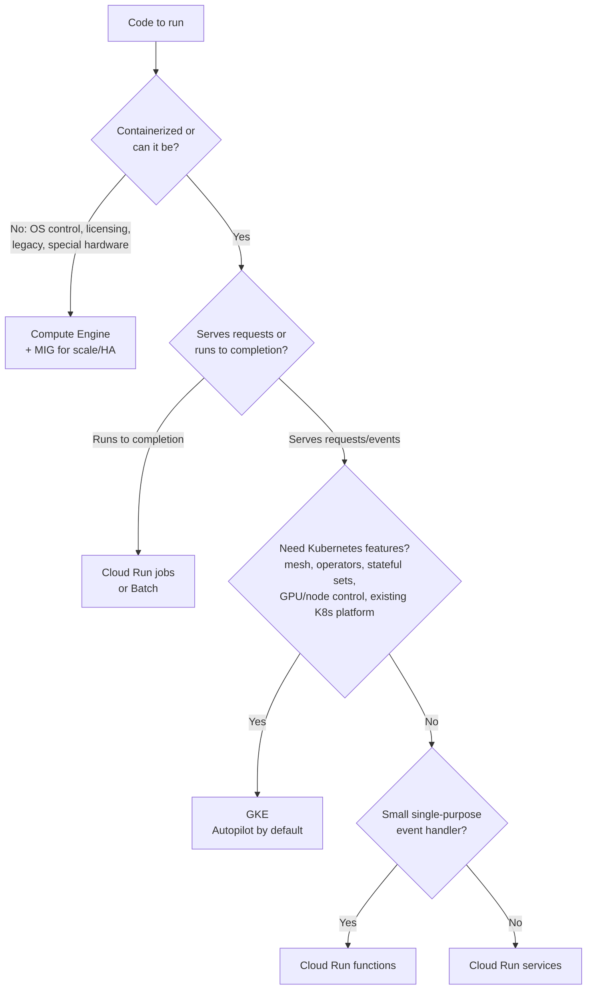
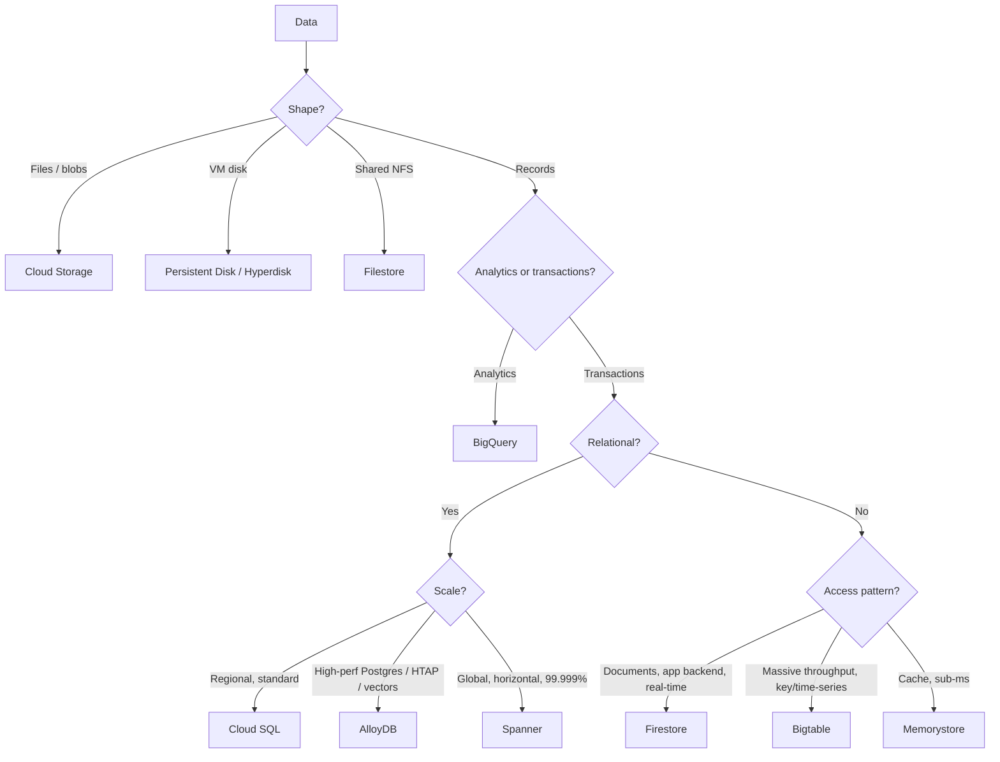

# Decision Trees

Most architecture decisions are one of these choices. Learn the *questions*. The answers follow.

## Compute: "where does my code run?"



## Database: "where does my state live?"



## Cloud Storage class

Access more than monthly → **Standard** · about monthly → **Nearline** (30-day minimum) · about quarterly → **Coldline** (90-day minimum) · about yearly or never → **Archive** (365-day minimum) · unknown pattern → **Autoclass**.

## Load balancer

```
HTTP(S)? ── yes ─► global users? ── yes ─► Global external Application LB (+ Cloud CDN, + Cloud Armor)
   │                   └─ no ─► residency/regional ─► Regional external ALB  |  internal ─► Internal ALB
   └─ no (TCP/UDP) ─► need client IP preserved / UDP / max performance? ── yes ─► Passthrough Network LB
                                                                └─ no ─► Proxy Network LB (TLS offload, global option)
```

## Connectivity

| Need | Choose |
|---|---|
| VPC ↔ VPC, same org, central network team | **Shared VPC** |
| VPC ↔ VPC, separate orgs/teams, non-transitive is fine | **VPC Network Peering** |
| Many VPCs and sites, hub-and-spoke | **Network Connectivity Center** |
| Private access to a Google or third-party service | **Private Service Connect** |
| Private VM → Google APIs | **Private Google Access** |
| Private VM → internet (outbound only) | **Cloud NAT** |
| Admin access to private VMs | **IAP TCP forwarding** |
| On-prem, quick/cheap, ≤ a few Gbps | **HA VPN** |
| On-prem, private, high bandwidth | **Dedicated Interconnect** (in a colo) / **Partner Interconnect** (through a provider) |
| Another cloud | **Cross-Cloud Interconnect** (or HA VPN) |

## Messaging and orchestration

| Need | Choose |
|---|---|
| Fan-out, decoupling, streaming ingest | **Pub/Sub** |
| React to GCP events (GCS upload, audit log) | **Eventarc** |
| Cron | **Cloud Scheduler** |
| Rate-limited, delayed HTTP calls to one target | **Cloud Tasks** |
| Multi-step service orchestration with retries and branches | **Workflows** |
| Data pipeline DAGs (Airflow) | **Cloud Composer** |
| Stream/batch transformation at scale | **Dataflow** |
| Existing Spark/Hadoop | **Dataproc** |
| Database CDC → BigQuery | **Datastream** |

## Identity: "how does X authenticate?"

| Who/what | How |
|---|---|
| Employee → GCP | Cloud Identity / Workspace account (often federated from the corporate IdP) + groups |
| Employee → internal web app or VM | **IAP** |
| End customer → your app | **Identity Platform** / Firebase Auth |
| GCP workload → GCP API | **Attached service account** (ADC). No keys |
| GKE pod → GCP API | **Workload Identity Federation for GKE** |
| GitHub Actions / AWS / on-prem → GCP API | **Workload Identity Federation** |
| Service → Cloud Run (private) | Caller's service account gets `roles/run.invoker`, sends an ID token |

## Availability target → design

| Target | Design |
|---|---|
| ~99% (internal tool) | Single zone OK, backups |
| 99.9% | Multi-zone in one region (regional MIG/GKE, Cloud SQL HA, Cloud Run) |
| 99.95–99.99% | Multi-zone + multi-region DR (warm standby, global LB) |
| 99.999% | Multi-region active-active (global LB + Spanner multi-region) |
