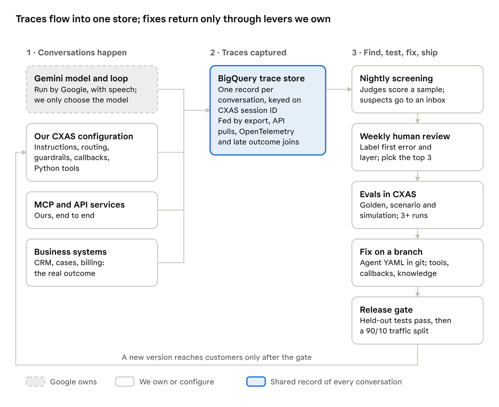
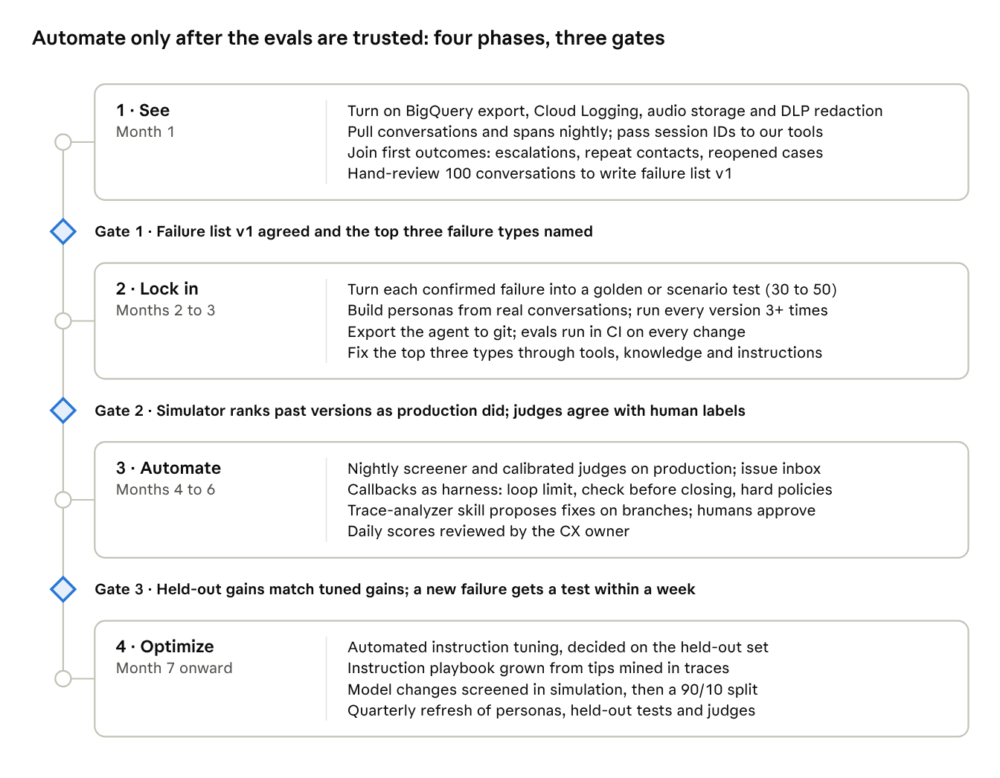

# Traces as Assets: Improving Our CX Agents

Nov 17, 2026 · Ammaar Saiyed

We cannot change the Gemini runtime inside GECX/CXAS, but most customer-facing failures trace back to layers we do own: instructions, routing, tools, knowledge and data. The design joins each conversation's platform log, our tool telemetry and its business outcome into one trace, pins every failure to a layer we can fix, locks each fix in as an eval against simulated customers, and turns the loop into a weekly habit with most of the reading automated.

## The plan on one page

We do not own the model or the agent loop, but CXAS gives us more control than it first appears: six callback hooks around every agent, model and tool call, versioned deployments with traffic splits, and a built-in evaluation suite with simulated users. The plan uses those, plus full ownership of our Python, MCP and API tools, to run one loop.

1. **Capture one trace per conversation.** Join the CXAS export (BigQuery, Cloud Logging, audio in Cloud Storage), our own tool telemetry and the business outcome (case reopened, repeat contact, refund issued) on the CXAS `session_id`. A trace without an outcome is only a log.
2. **Read traces every week, then automate the reading.** Humans review a sample, note the first thing that went wrong in each, and keep a short list of CX failure types. A Gemini screener then flags suspect conversations nightly and humans accept or reject.
3. **Pin every failure to a layer we can fix.** Platform model, our instructions, routing between agents, a tool, the knowledge base, or the channel (speech recognition, latency). Platform-level faults go to Google with trace evidence; everything else gets a fix.
4. **Lock in every fix as an eval.** Each confirmed failure becomes a CXAS golden or scenario test with a pass/fail rule, run 3+ times against simulated customers built from real conversations. Reliability is measured as "passes every time" (pass^k), not "passed once".
5. **Fix through the levers we own, cheapest first.** Tool bugs and error messages, then tool design, then knowledge, then instructions and examples, then routing, then callbacks as our harness (loop limits, pre-completion checks, escalation rules). Automated instruction tuning comes last, behind the eval gate.
6. **Ship behind gates.** New version, full eval suite against the current version, 90/10 traffic split, watch outcomes, then widen. The same gate runs whenever Google changes the underlying Gemini model.

## What we control

Google owns the model, the agent loop and speech; we own or configure everything else, and every layer leaves a trace we can capture.

| Layer | Owner | What we can change | What it records | Where we get it |
| --- | --- | --- | --- | --- |
| Gemini model and agent loop | Google | Model per agent, fallback and retry settings; nothing inside the loop | Model calls, latency | CES `GetConversation` spans; BigQuery export |
| [Callbacks](https://docs.cloud.google.com/gemini-enterprise-cx/cx-agent-studio/callback) (before/after agent, model, tool) | Us, in Google's sandbox | Inspect, change or skip any model or tool call; set variables; escalate; end the session | Our `print` output in span attributes; custom payloads the model never sees | `GetConversation` spans, [`cxas trace`](https://github.com/GoogleCloudPlatform/cxas-scrapi/pull/533) |
| Instructions (global and per agent) and guardrails | Us | Wording, policies, examples, persona; guardrail rules | Behaviour in model spans; guardrail spans | Agent export (YAML) in git |
| Routing (root agent, sub-agents) | Us | Agent boundaries, transfer rules | Which agent handled each turn; handoffs | Conversation turns |
| Python tools inside CXAS | Us | Code, descriptions, outputs, error text | Arguments, outputs, stdout, errors; tool failure and latency metrics | Tool spans; CXAS tracing metrics |
| MCP and OpenAPI tools | Us, end to end | Schema, descriptions and the service behind them | Our own server traces plus the CXAS tool span | Cloud Trace and Logging, keyed by session ID |
| Knowledge (data store tools) | Us (content), Google (retrieval) | Documents, FAQs, which store each agent uses | Retrieved content; hallucination checks in evals | Tool spans; eval results |
| Our Python services that call the CXAS runtime | Us | Everything | Full OpenTelemetry traces; session responses and payloads | Cloud Trace and Logging |
| Channel: voice and chat | Google (speech), our contact-centre and chat vendors | Speaking-style prompt, voice model, chat UI | Audio, interruptions, latency | Audio in Cloud Storage; `interrupted` events |
| Business systems (CRM, cases, billing) | Us | Nothing, they are the ground truth | Resolved, reopened, repeat contact, refund, CSAT | Joined in BigQuery |

The practical consequence: **callbacks and tools are our harness.** The changes that lifted LangChain's coding agent by 13.7 points without touching the model were all of this kind: a check before the agent may finish, loop detection, time warnings ([source](https://www.langchain.com/blog/improving-deep-agents-with-harness-engineering)). Each can be approximated with a CXAS callback or a tool response.

Open question for Google: which span types `GetConversation` returns for our app, and whether the BigQuery export carries tool arguments unredacted.

## Architecture

Google's model and loop are the only part we cannot change; where traces land, how they are read and how fixes ship are all ours.

## Capture: one trace per conversation

Every conversation becomes one record in BigQuery, keyed on the CXAS `session_id`, with its turns, its spans, the version that served it and an outcome that arrives days later.

| Table | One row per | Key fields | Filled from |
| --- | --- | --- | --- |
| `conversations` | Conversation | session ID, channel (voice/chat), app version, model per agent, start/end, pseudonymous customer key, source (production, simulation, eval) | CXAS BigQuery export; deployment metadata |
| `turns` | Turn | speaker, text (redacted), agent that answered, interruptions, latency | CXAS export; `GetConversation` |
| `spans` | Model, tool, callback or guardrail call | type, name, arguments, output, error, duration, stdout | `GetConversation` pulled nightly ([cxas-scrapi](https://github.com/GoogleCloudPlatform/cxas-scrapi)); our OpenTelemetry traces |
| `outcomes` | Conversation, filled late | resolved, escalated (and what the human then did), case reopened in 7 days, repeat contact in 7 days, refund or credit issued, CSAT/tNPS | CRM, case and billing systems |
| `labels` | Human or AI review | failure type, first turn that went wrong, layer at fault, severity, reviewer | Review tool (see Making it easy) |
| `eval_links` | Eval case | which trace it came from, which fix it guards | Eval pipeline |

Five rules make this work:

1. **Carry the session ID into every tool call.** Add an optional `cx_session_id` field to our MCP and OpenAPI tool schemas and fill it in a `before_tool_callback` from `callback_context.session_id`. Our services then tag their OpenTelemetry spans with it, and Cloud Trace joins to the CXAS trace.
2. **Log from inside the managed runtime with `print`.** The CES runtime stores `print` and stderr output from Python tools and callbacks on the span ([source](https://github.com/GoogleCloudPlatform/cxas-scrapi/pull/533)). One shared callback that prints a JSON line per tool result (tool, ok, ms, retry count) gives us structured telemetry Google does not record. Callbacks cannot reach private endpoints, so print rather than post.
3. **Stamp every conversation with versions.** CXAS versions are immutable and channels point at them ([source](https://docs.cloud.google.com/gemini-enterprise-cx/cx-agent-studio/deploy/migrate-model)). Record the version, the model per agent, the git commit of the exported agent YAML and the knowledge snapshot date; without them no change can be credited or blamed.
4. **Join outcomes late.** The best signals arrive after the call: a reopened case or a repeat contact within 7 days is a failure the transcript cannot show. Vercel's Agent Runs docs say it plainly: traces record what the agent did, and "your application and connected systems must supply the approval and outcome records" ([source](https://vercel.com/docs/agent-runs)).
5. **Simulated and eval conversations land in the same tables.** Nubank found that when simulation traces don't match production schemas and IDs, "export and reconciliation work can erase the iteration gains" ([source](https://arxiv.org/html/2609.30137)). A `source` column keeps them apart.

**Privacy and retention.** Turn on CXAS DLP redaction, which is applied before anything is stored; Google-managed history keeps 1 year by default, up to 2 ([source](https://docs.cloud.google.com/gemini-enterprise-cx/cx-agent-studio/conversation-history)). In our own tables, keep raw traces about 90 days and keep any trace that is labelled, linked to an eval or tied to an incident for as long as policy allows, because by then it is an asset. Pseudonymise customer keys and hold the re-identification map separately.

## Finding where the issues are

Most failures sit in layers we own, and only reading conversations reveals them. LATAM's dashboards showed 13% of messages as out of scope; reading traces showed 95% of those were real needs like baggage and check-in, and one new specialist agent cut the rate to 1% ([source](https://www.langchain.com/blog/customer-experience-cx-agents-in-production-lessons-from-lyft-vodafone-and-latam-airlines)). In 1,600+ annotated multi-agent traces, two of the three failure categories were system design and misalignment between agents, both things the builder controls ([MAST](https://arxiv.org/abs/2503.13657)).

**The weekly review (by hand first).** This follows Husain and Shankar's method ([source](https://lennysnewsletter.com/p/advanced-evals-how-to-find-and-fix)).

1. Sample about 100 conversations: some at random, some flagged (low CSAT, escalated, repeat contact, tool errors, unusually long), and some that "succeeded". A pass can hide a failure; Vercel found an agent "passing" a task by giving up ([source](https://vercel.com/blog/agent-evals)).
2. For each failure, write one plain note on the **first** thing that went wrong. Later errors usually cascade from it.
3. Group the notes into failure types, starting from the list below but letting the data change it. Keep an "unknown" bucket.
4. Assign each failure to the cheapest layer that could have prevented it, then rank types by frequency times severity and fix the top three.

| Failure type | How it shows in the trace | Layer usually at fault | First lever |
| --- | --- | --- | --- |
| Wrong routing or misread intent | Wrong sub-agent answers; customer rephrases; real needs labelled out of scope | Routing, instructions | Fix routing rules; add a sub-agent or examples |
| Wrong or missing tool call, bad arguments | Expected tool absent; 4xx errors; retries | Tool descriptions and schemas | Rewrite descriptions; return errors that say how to fix the call |
| Tool or backend failure | 5xx, timeouts, empty results | Our services | Fix the service; add a fallback message |
| Claim not supported by tools or knowledge | Answer contradicts tool output; eval hallucination flag | Knowledge, instructions | Ground in a data store; check in `after_model_callback` |
| Knowledge gap | "I can't help with that" on common questions; empty retrievals | Knowledge | Add content for the top unanswered clusters |
| Policy or compliance miss | Required disclosure absent; identity check skipped | Instructions, guardrails | Enforce in a callback, not in prose |
| Escalation too early or too late | Human fixes it in a minute with data the agent had; or the agent loops while the customer asks for a person | Instructions, callbacks | Explicit escalation rules; a turn or retry counter that escalates |
| Loops and repetition | Same tool call or question repeated | Callbacks | Loop detection in `before_tool_callback` |
| Gave up or ended early | Session ends with no action and no resolution | Instructions, callbacks | A check before the agent may close |
| Missed the real need | Literal question answered, goal not served | Instructions, examples | Examples and playbook tips from good conversations |
| Voice: misheard, slow or talked over | Repeated "could you repeat"; long silences; `interrupted` events | Channel, tools | Read-back confirmation of numbers; faster or async tools; shorter replies |

The last-but-one row is the one dashboards never show. In Husain and Shankar's leasing-assistant example, a reply that ended the chat when a unit was over budget looked fine but lost a sale; the team saw it only by reading the trace.

**Then automate the reading.** The pattern every team converged on: a cheap model screens compressed outlines of every conversation; investigator agents open the full trace for suspect ones and file findings in the fixed categories; a person accepts or rejects ([LangSmith Engine](https://www.langchain.com/blog/how-we-built-langsmith-engine-our-agent-for-improving-agents); Vercel uses up to 40 parallel reader agents; Cisco's triage agent opens Jira tickets and humans design the fixes). Keep the human gate. The best model scored only 11% at locating errors in agent traces ([TRAIL](https://arxiv.org/abs/2505.08638)), and in Husain and Shankar's 100-trace study they missed failures that need product judgment while flagging good responses as bad.

**When the fault is Google's.** If the model ignores a clear instruction or a correct tool output, first try compensating in a callback. Then file it with Google with session IDs and spans, and add the case to the eval suite so the next model version is tested against it.

## Evals: turning traces into tests

CXAS already ships the machinery: golden, scenario and simulation tests, simulated customers with personas, tool mocks and repeat runs ([source](https://docs.cloud.google.com/gemini-enterprise-cx/cx-agent-studio/evaluation)). Our work is feeding it from production traces and making its verdicts trustworthy.

| Test type | Built from | Passes when | Use it for |
| --- | --- | --- | --- |
| Golden | A real conversation, picked by ID from conversation history, or a simulator run saved as golden | Responses match semantically; expected tool calls and arguments occur; handoff happens as expected | Regression: every confirmed production failure becomes one |
| Scenario | A customer goal plus must-have and must-not-have tool calls or messages | Simulated customer's goal is met with no violations | Each failure type, across personas |
| Simulation | An ordered list of goals (for example identify, find order, reschedule) | Every step completes | End-to-end journeys |

**1. Every fix ships with its eval.** Turn the failing conversation into a golden, with "stable replay" and tool fakes so it runs without live backends. Confirm it fails on the old version and passes on the new one; an eval that never failed proves nothing ([LangSmith Engine](https://www.langchain.com/blog/how-we-built-langsmith-engine-our-agent-for-improving-agents) only accepts an evaluator once it catches the original failing traces).

**2. Make the simulated customers realistic; this is the main risk.** Lyft's first simulated customers were too cooperative and passed over 90% of tests. Training the simulator on real customer wording and adding personas such as refund seekers and people determined to reach a human made offline results predictive ([source](https://www.langchain.com/blog/customer-experience-cx-agents-in-production-lessons-from-lyft-vodafone-and-latam-airlines)). Nubank derived personas and use-case mixes from historical conversations; its simulator's scores tracked production at r = 0.74, while a naive two-prompt simulator scored r = -0.09 ([source](https://arxiv.org/html/2609.30137)). For us:

- Build CXAS personas from clusters of real conversations: intent times style (terse, angry, confused, second-language speaker, noisy line).
- Weight scenarios by how often each intent occurs in production.
- Before trusting the simulator, check that its scores rank two or three past versions the same way production did.

**3. Pass/fail rules, not scores.** Generic "helpfulness" scores gave Lyft numbers but no direction; narrow rubrics such as "escalated correctly" pointed at a specific fix. Shopify warns against judges that "rate this 0–10" and calibrated its judge from near-random agreement (kappa 0.02) to 0.61, against 0.69 between human experts ([source](https://shopify.engineering/building-production-ready-agentic-systems)). Calibrate every LLM judge against about 100 human labels and re-check it quarterly.

**4. Measure reliability, not luck.** Run every case at least three times, which CXAS also recommends. For journeys where one failure is costly (payments, cancellations, identity), require all runs to pass (pass^k, from Sierra's [tau-bench](https://arxiv.org/abs/2406.12045)): an agent that succeeds 60% of the time passes five runs in a row only 8% of the time ([source](https://vercel.com/blog/agent-evals)).

**5. Keep a held-out set.** Tune instructions against one set of cases and decide releases on another the tuning never saw. Keep voice and chat cases separate, as CXAS advises, and include cases the agent must refuse.

**6. Score production too.** Fastweb and Vodafone score every day's traces overnight, with the violated guideline named, and business owners review the results to hold a 90% correctness target ([source](https://www.langchain.com/blog/customer-experience-cx-agents-in-production-lessons-from-lyft-vodafone-and-latam-airlines)). Run our calibrated judges on a daily production sample the same way.

CXAS can also write a loss report and suggest fixes ("Find issues with AI" and "Ask Gemini", in preview, single-agent apps only). Treat these as proposals: Google's own guidance is to check suggested changes against real transcripts first.

## Improvement levers, in order

Work down this list: each step costs more and reaches more customers than the one before, and automated instruction tuning only pays once the evals can be trusted.

1. **Fix tool and backend bugs, and make errors instructive.** The cheapest wins are defects that traces expose. Fixing the missing packages and network access that transcripts exposed lifted GPT-4o on one benchmark from 68.6% to 78% ([Docent](https://transluce.org/introducing-docent)). For us: an API that answers `400 invalid date` should answer "use YYYY-MM-DD; today is 2026-11-17" so the model can recover in one turn.
2. **Redesign tools from their traces.** Anthropic pasted eval transcripts into Claude and let it rewrite tool descriptions; the rewritten tools beat human-written ones on held-out tests ([source](https://www.anthropic.com/engineering/writing-tools-for-agents)). Vercel cut 80% of a data agent's tools and it got 3.5 times faster ([source](https://vercel.com/blog/we-removed-80-percent-of-our-agents-tools)). For us: merge overlapping tools (order, status, shipping), return only the fields the agent needs, and add a next-step hint to each response.
3. **Fill knowledge gaps.** Cluster the questions the agent could not answer and write the missing content. Put core policy where it is always in context, the instructions, rather than behind a data store call the agent must decide to make: Vercel's always-loaded docs index scored 100% where an on-demand skill scored 79%, because the agent skipped the skill 56% of the time ([source](https://vercel.com/blog/agents-md-outperforms-skills-in-our-agent-evals)).
4. **Edit instructions and add examples from real conversations.** Make targeted edits per failure type, never wholesale rewrites, which erode detail ([ACE](https://arxiv.org/abs/2510.04618)). Add short excerpts of conversations that went well: reusing an agent's own successful runs as examples raised one benchmark from 73% to 89% ([source](https://arxiv.org/abs/2505.00234)). Keep a playbook of tips mined from traces in three kinds, as IBM did for a 14.3-point gain: what worked, how a failure was recovered, and how a slow success could be faster ([source](https://arxiv.org/abs/2603.10600)). Adopt a tip only when several conversations agree on it; Glean learns nothing from a conflict ([source](https://www.glean.com/blog/trace-learning-tech-story)).
5. **Re-cut the routing.** Add, split or merge sub-agents where failures cluster. LATAM's new customer-care specialist now handles about 12% of daily messages; restructuring who formats output cut its cost by about 15% ([source](https://www.langchain.com/blog/customer-experience-cx-agents-in-production-lessons-from-lyft-vodafone-and-latam-airlines)).
6. **Use callbacks as our harness.** Move rules that must always hold out of prose and into code (table below). Review them at every model upgrade; LangChain calls such guardrails temporary fixes for current model limits.
7. **Tune instructions automatically, last.** Optimizers that read failing traces and rewrite text (GEPA, Arize Prompt Learning, Google's Agent Optimizer, CXAS's Ask Gemini) work, but they exploit weak evals. Give them raw traces, not summaries: in Meta-Harness, an optimizer reading raw traces reached a median score of 50.0, against 34.9 with summaries and 34.6 with scores alone. Point them at one section at a time; in one study almost all the gain came from the control and reflection rules ([source](https://arxiv.org/abs/2609.02889)). For us that probably means the escalation and closing rules. Reject edits that only fit the test cases, and decide on the held-out set.
8. **Change the model, behind the full gate.** CXAS lets each agent pick its model; follow Google's migration steps: baseline, 3+ eval runs, a 90/10 traffic split, rollback ready ([source](https://docs.cloud.google.com/gemini-enterprise-cx/cx-agent-studio/deploy/migrate-model)). Nubank screened 29 configurations in 16,000 simulated conversations before a live test that raised self-service by 8.82 points. At each upgrade, also try removing callbacks and instructions the new model may not need.

**Callbacks as our harness**

| Pattern | Hook | What it does |
| --- | --- | --- |
| Loop limit | `before_tool_callback` | Counts identical tool calls in a session variable; on the third, skips the call and returns "stop retrying; offer a transfer" |
| Hard policy | `before_tool_callback` | Blocks a refund above the limit unless an identity-verified variable is set |
| Check before closing | `after_model_callback` | If the reply closes the conversation but no reference number was issued, replaces it with a prompt to finish the step |
| Turn budget | `before_model_callback` | After N turns, adds guidance to summarise and offer a human |
| Voice shaping | `after_model_callback` | Shortens replies and reads numbers back digit by digit |
| Telemetry | `after_tool_callback` | Prints one JSON line per tool result, captured on the span |
| Escalation context | `after_model_callback` | Attaches a payload for the human agent that the model never sees |

These mirror the changes that lifted LangChain's agent from 52.8% to 66.5% with the model unchanged: a pre-finish checklist, loop detection and time warnings ([source](https://www.langchain.com/blog/improving-deep-agents-with-harness-engineering)).

## Making it easy

The loop survives only if it costs the team about an hour of human time a week: machines do the capture, screening, scoring and test drafting, and people spend their time on judgment.

| When | What happens | Who | Automated |
| --- | --- | --- | --- |
| Nightly | Pull conversations and spans into BigQuery, join outcomes, score a sample with calibrated judges, screener flags suspects into an issue inbox | Pipeline | Fully |
| Weekly, 60 min | Review flagged and random conversations, accept or reject AI findings, update failure types, pick the top three, turn each confirmed issue into a test | CX owner, QA leads, AI engineer | Drafts are automated; decisions are human |
| Every change | Full eval suite (3+ runs) on the candidate version against the live one; the change request shows evidence sessions and eval deltas | AI engineer | Fully |
| Every release | 90/10 traffic split, watch outcomes for a few days, widen or roll back | AI engineer, CX owner | Mostly |
| Every model change | Full suite on baseline and candidate; try removing callbacks the new model may not need | AI engineer | Mostly |
| Quarterly | Refresh the held-out set and personas from recent traffic, recalibrate judges, audit retention and access | CX owner, AI engineer | Partly |

**Roles.** One CX domain owner decides what "good" means; Husain and Shankar recommend a single domain expert as the arbiter rather than a committee. QA leads who already score human agents run the weekly review. AI engineers own capture, callbacks, tools and the eval pipeline. Tool and backend owners receive tool-failure tickets directly.

**Tooling that removes friction.**

- **A trace viewer built for our conversations.** One screen: turns, tool calls, the version, the outcome, and a label form. Husain's top advice is a custom viewer, because generic dashboards hide the details that matter.
- **One click from conversation to test.** CXAS can create a golden from a conversation ID; a helper drafts the expectations for a human to confirm.
- **Agent as code.** Export the app to YAML in git, so every instruction and tool change is a reviewed diff and CI runs the evals through the API.
- **A trace-analyzer skill for a coding agent.** LangChain packaged its loop as a skill: fetch traces, fan out parallel error-analysis agents, combine findings, propose targeted changes ([source](https://www.langchain.com/blog/improving-deep-agents-with-harness-engineering)). Ours reads conversations through [cxas-scrapi](https://github.com/GoogleCloudPlatform/cxas-scrapi), which works with Gemini CLI and Claude Code. It proposes edits on a branch through the [CXAS MCP server](https://docs.cloud.google.com/gemini-enterprise-cx/cx-agent-studio/mcp-server), which can update instructions, run evaluations and export and import the app. A person approves every change that reaches customers.

**Metrics that show the loop works**

| Metric | What it tells us |
| --- | --- |
| Resolved with no repeat contact in 7 days | True resolution; containment alone counts customers who gave up |
| CSAT or tNPS, by failure type | Which failures customers feel |
| Escalations a human closed in under 2 minutes | Escalations the agent should have handled |
| Pass^k on critical journeys | Reliability, not lucky passes |
| Policy violations and unsupported claims per 1,000 conversations | Risk exposure |
| p95 voice response latency | Dead air |
| Days from first occurrence of a failure to a test that guards it | Speed of the loop |
| Share of the top 10 failure types covered by tests | Coverage |
| Judge agreement with human labels | Whether automated scores can be trusted |
| Gain on tuned cases versus held-out cases | Overfitting |
| Share of findings in the "unknown" bucket | Whether the failure list is going stale |

## Rollout

A phase ends when its gate passes, not when its months run out; the timings are a starting estimate. Automation waits until Gate 2 proves the simulator and judges agree with production and with people.

## What others did and what we take

The teams with the strongest CX results all read traces, simulate before shipping and gate releases on calibrated evals; the research explains why each piece matters and where it breaks.

**Customer-experience teams**

| Who | What they did | What we take |
| --- | --- | --- |
| [Nubank](https://arxiv.org/html/2609.30137) | Screened every agent change in simulation first; personas and use-case mix derived from past conversations; tools mocked at the boundary | Simulate before shipping. A realistic simulator tracked production at r = 0.74, a naive one at -0.09. Cycle time per version fell from 21.2 to 4.4 days; one release lifted tNPS 36.69 points |
| [Lyft](https://www.langchain.com/blog/customer-experience-cx-agents-in-production-lessons-from-lyft-vodafone-and-latam-airlines) | Offline evals as a launch gate; simulator trained on real customer wording; narrow pass/fail rubrics; failed traces routed to annotation queues | Adversarial personas; an "escalated correctly" rubric; judges tuned to human labels |
| [Fastweb and Vodafone](https://www.langchain.com/blog/customer-experience-cx-agents-in-production-lessons-from-lyft-vodafone-and-latam-airlines) | Score every day's traces overnight, naming the violated guideline; business owners adjust prompts to hold 90% correctness | Daily production scoring that business owners read |
| [LATAM Airlines](https://www.langchain.com/blog/customer-experience-cx-agents-in-production-lessons-from-lyft-vodafone-and-latam-airlines) | Trace reading showed most "out of scope" messages were real needs; a new specialist cut that rate from 13% to 1% | Dashboards hide routing failures; read conversations |
| [Shopify Sidekick](https://shopify.engineering/building-production-ready-agentic-systems) | Test sets sampled from production; judge calibrated from kappa 0.02 to 0.61 against 0.69 between humans; merchant simulator replays real goals | Build test sets from production; human agreement is the judge's ceiling |
| Cisco (same LangChain source) | A triage agent pulls failing traces, groups them and opens Jira tickets; humans design fixes | Automate triage, keep fixes human |
| [Nurture Boss](https://lennysnewsletter.com/p/advanced-evals-how-to-find-and-fix) (Husain and Shankar) | Found a lost-sale failure only by reading traces; agents reviewing traces caught in-trace errors but missed product judgment | Weekly human review; note the first thing that went wrong |
| [Glean](https://www.glean.com/blog/trace-learning-tech-story) | Distils traces into guidance; learns nothing when traces conflict; keeps company-wide and per-user memory apart | Adopt a lesson only when several conversations agree |

**Agent builders and platforms**

| Who | What they did | What we take |
| --- | --- | --- |
| [Vercel, agent evals](https://vercel.com/blog/agent-evals) | "Scores tell you how often your agents fail; traces tell you why"; reads passing traces too; up to 40 reader agents summarise runs in parallel | Read passes; pick pass^k for costly failures |
| [Traces joins Vercel](https://traces.com/blog/traces-vercel) | Vercel is taking on Traces, a hub where teams share and resume coding-agent sessions (about 500,000 shared) as "a living team memory" | Our own build sessions are an asset too: keep the sessions behind each agent change with the change |
| [LangChain Deep Agents](https://www.langchain.com/blog/improving-deep-agents-with-harness-engineering) | 52.8% to 66.5% on Terminal-Bench 2.0 with only harness changes, found by a trace-analyzer skill | Callbacks as harness; package the loop as a skill |
| [LangChain evals](https://www.langchain.com/blog/how-we-build-evals-for-deep-agents) | "Every eval is a vector that shifts the behavior of your agentic system"; correctness first, then efficiency against an ideal path | Few, targeted evals; measure wasted turns only on correct runs |
| [Anthropic](https://www.anthropic.com/engineering/writing-tools-for-agents) | Claude rewrote tools from eval transcripts and beat human-written tools on held-out tests | Redesign our MCP and API tools from their traces |
| [Google Agent Platform](https://cloud.google.com/blog/products/ai-machine-learning/introducing-gemini-enterprise-agent-platform) | Agent Simulation, live-traffic multi-turn autoraters, and an optimizer that clusters failures and suggests instructions | Candidate tooling for our Python services; confirm coverage of CXAS apps |

**Research**

| Work | Finding | What we take |
| --- | --- | --- |
| [Meta-Harness](https://arxiv.org/abs/2603.28052) | An optimizer reading raw traces reached a median 50.0, against 34.9 with summaries and 34.6 with scores only | Give analysis agents full traces |
| [GEPA](https://arxiv.org/abs/2507.19457) | Rewriting prompts by reflecting on traces beat reinforcement learning with up to 35 times fewer runs | Tune instructions and judge prompts this way (Nubank tuned its judges with GEPA) |
| [ACE](https://arxiv.org/abs/2510.04618) | A playbook grown by small edits beat rewrites, which drop detail | Edit instructions incrementally |
| [IBM](https://arxiv.org/abs/2603.10600) | Tips mined from traces (what worked, how failures were recovered, what was slow) added 14.3 points | Our instruction playbook |
| [Where harness value lives](https://arxiv.org/abs/2609.02889) | Almost all gains sat in control and reflection rules | Tune escalation and control rules first |
| [RRSI](https://arxiv.org/abs/2609.24972) | Self-improvement loops overfit unless edits are limited and benchmark-specific changes rejected | Held-out gate; reject case-specific edits |
| [MAST](https://arxiv.org/abs/2503.13657), [TRAIL](https://arxiv.org/abs/2505.08638) | Two of three failure categories are system design and agent misalignment; the best model scored 11% at locating errors in traces | Fix design first; keep a human gate |
| [HAL with Docent](https://arxiv.org/abs/2510.11977) | Log analysis across 21,730 runs found agents searching for benchmark answers instead of solving tasks, and misusing credit cards in flight bookings | Audit conversations that "passed" |
| [MINJA](https://arxiv.org/abs/2503.03704) | Ordinary queries alone, with no access to the memory store, could plant malicious records in an agent's memory | Never let live traffic write to shared memory |
| [Context graphs](https://ashugarg.substack.com/p/ais-trillion-dollar-opportunity-context), [Save the trace](https://www.signalfire.com/blog/save-ai-agent-traces) | Decision records linked across cases make precedent searchable; most teams throw their traces away | Keep traces as a governed asset, not debug logs |

## Risks

The two risks most likely to hurt us are customer data leaking through the trace store and a quiet model change on Google's side; both have standard mitigations we should build in from day one.

| Risk | What could happen | Mitigation |
| --- | --- | --- |
| Customer data in traces | Card numbers, health or identity data copied into BigQuery, prompts or eval cases | CXAS DLP redaction before storage; pseudonymous customer keys; restricted access to raw tables; retention limits; recording consent on voice |
| Google changes the model | Behaviour shifts with no change on our side | Channels pinned to versions; the full eval suite on every model change; 90/10 split before widening |
| Overfitting to our own tests | Scores rise while real conversations do not improve | Held-out cases the tuning never sees; reject edits that only fit test cases; refresh tests quarterly from new traffic |
| Judges drift or flatter us | Automated scores stop matching human judgment | Quarterly recalibration against human labels; track agreement as a metric |
| Unrealistic simulated customers | Offline passes that production does not confirm | Check that the simulator ranks past versions as production did; adversarial personas; refresh personas from real wording |
| Automated fixes reach customers unreviewed | A plausible but wrong instruction ships | Human approval on every customer-facing change, including CXAS's AI-suggested fixes |
| Poisoned learning | A customer plants text that becomes a learned tip or memory | Learn offline from reviewed traces only; tips go through review; nothing in live traffic writes to shared instructions |
| Containment that hides failure | Customers who give up count as contained | Judge success by no repeat contact within 7 days, not by containment |
| Callbacks grow into a hidden harness | Rules pile up, interact and slow turns | Callbacks in git with their own tests; review and prune at every model upgrade |
| Preview APIs and tools change | Pipeline breaks when beta APIs or cxas-scrapi change | Pin versions; keep a thin adapter between our pipeline and the CES API |

## Sources

**Google CX Agent Studio and tooling**

- [Evaluation](https://docs.cloud.google.com/gemini-enterprise-cx/cx-agent-studio/evaluation) · [Conversation history](https://docs.cloud.google.com/gemini-enterprise-cx/cx-agent-studio/conversation-history) · [Callbacks](https://docs.cloud.google.com/gemini-enterprise-cx/cx-agent-studio/callback) · [Python runtime reference](https://docs.cloud.google.com/gemini-enterprise-cx/cx-agent-studio/reference/python)
- [Migrate to a new model](https://docs.cloud.google.com/gemini-enterprise-cx/cx-agent-studio/deploy/migrate-model) · [CX Agent Studio MCP server](https://docs.cloud.google.com/gemini-enterprise-cx/cx-agent-studio/mcp-server) · [CES API reference](https://docs.cloud.google.com/gemini-enterprise-cx/cx-agent-studio/reference/rpc/google.cloud.ces.v1)
- [cxas-scrapi](https://github.com/GoogleCloudPlatform/cxas-scrapi) and its [trace PR #533](https://github.com/GoogleCloudPlatform/cxas-scrapi/pull/533) · [Introducing Gemini Enterprise Agent Platform](https://cloud.google.com/blog/products/ai-machine-learning/introducing-gemini-enterprise-agent-platform)

**Customer-experience case studies**

- [Screen Before You Serve (Nubank)](https://arxiv.org/html/2609.30137) · [CX agents in production: Lyft, Vodafone, LATAM](https://www.langchain.com/blog/customer-experience-cx-agents-in-production-lessons-from-lyft-vodafone-and-latam-airlines) · [Shopify Sidekick](https://shopify.engineering/building-production-ready-agentic-systems)
- [Husain and Shankar, Advanced evals](https://lennysnewsletter.com/p/advanced-evals-how-to-find-and-fix) · [Glean, Trace learning](https://www.glean.com/blog/trace-learning-tech-story)

**Agent builders and platforms**

- Vercel: [Agents are users, so your software needs evals](https://vercel.com/blog/agent-evals) · [Agent Runs docs](https://vercel.com/docs/agent-runs) · [We removed 80% of our agent's tools](https://vercel.com/blog/we-removed-80-percent-of-our-agents-tools) · [AGENTS.md outperforms skills](https://vercel.com/blog/agents-md-outperforms-skills-in-our-agent-evals) · [Traces is joining Vercel](https://traces.com/blog/traces-vercel) · [Traces](https://traces.com/)
- LangChain: [Improving Deep Agents with harness engineering](https://www.langchain.com/blog/improving-deep-agents-with-harness-engineering) · [How we build evals for Deep Agents](https://www.langchain.com/blog/how-we-build-evals-for-deep-agents) · [How we built LangSmith Engine](https://www.langchain.com/blog/how-we-built-langsmith-engine-our-agent-for-improving-agents)
- [Anthropic, Writing effective tools for agents](https://www.anthropic.com/engineering/writing-tools-for-agents) · [Transluce, Introducing Docent](https://transluce.org/introducing-docent)

**Research**

- [Meta-Harness](https://arxiv.org/html/2603.28052v1) · [GEPA](https://arxiv.org/abs/2507.19457) · [ACE](https://arxiv.org/abs/2510.04618) · [Trajectory-informed memory (IBM)](https://arxiv.org/abs/2603.10600) · [Self-generated in-context examples](https://arxiv.org/abs/2505.00234)
- [Where does harness-optimization value live?](https://arxiv.org/abs/2609.02889) · [RRSI](https://arxiv.org/abs/2609.24972) · [MAST](https://arxiv.org/abs/2503.13657) · [TRAIL](https://arxiv.org/abs/2505.08638) · [HAL](https://arxiv.org/abs/2510.11977) · [MINJA](https://arxiv.org/abs/2503.03704) · [tau-bench](https://arxiv.org/abs/2406.12045)

**Traces as a business asset**

- [Foundation Capital, Context graphs](https://ashugarg.substack.com/p/ais-trillion-dollar-opportunity-context) · [SignalFire, Save the trace](https://www.signalfire.com/blog/save-ai-agent-traces)
